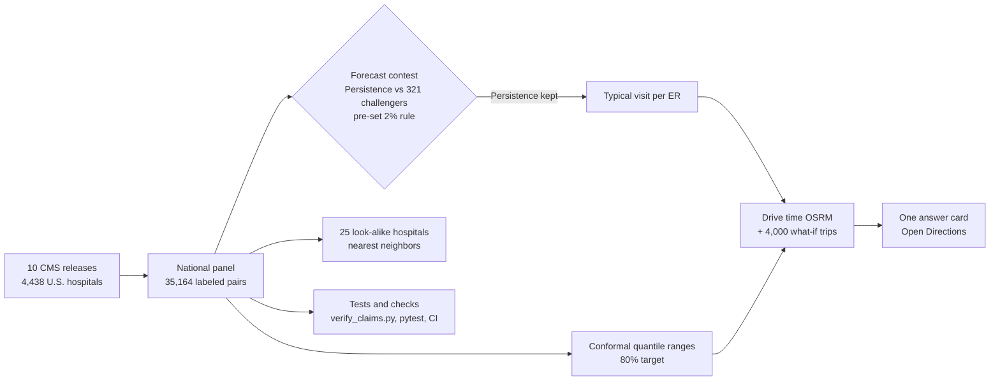

# ERNow Boston

[](https://github.com/ishaannars/ERNow-Boston/actions/workflows/tests.yml)

**Project goal:** “Find the ER that gets you seen and home fastest, not just the closest, lowering the decision time between needing one and finding a good one you can use.”

<!-- RECRUITER-TOP -->
**[Try ERNow Boston →](https://ernowboston.streamlit.app/)**

**9 s vs 20 s** to pick an ER (timed test, 5 people each) · **9.4-min** average error, R² 0.93, on 4,017 hospitals it never saw · picked the fastest local ER **83% vs 24%** by chance.


**Compare ERs in about 10 seconds. Find the shortest estimated total visit, not just the closest.**

The 10-second headline rounds the recorded nine-second median from five ERNow participants. It describes decision time, not treatment or discharge time; speed varies. ERNow combines road travel with forecasts of hospital arrival-to-departure medians to compare total time through a visit.

ERNow uses historical CMS performance to compare seven general emergency departments, with specialist, pediatric, and veterans’ services listed separately. The national panel contains **4,438 eligible reporting hospitals** and **35,164 labeled release pairs** across ten saved CMS releases. It does not measure a live queue, time to first clinician, clinical suitability, or your personal visit length.

[Try ERNow Boston](https://ernowboston.streamlit.app/)

> Possible emergency? Call 911 or go to the nearest appropriate emergency department. Do not delay care or drive farther because of an ERNow estimate.

## How it works



## Every factor tested

Only factors that make ERNow more accurate are used. Everything else is tested, reported, and left out.

<!-- FACTORS:START -->
| Factor | Data | Usable live? | Result | Used in ERNow? |
|---|---|---|---|---|
| Last published ED visit time | CMS (OP-18b) | Yes | Most accurate option: 9.4-min average error on 4,017 hospitals it never saw | ✅ Center estimate |
| Past trend, other ED measures, hospital traits, state and peer averages | CMS | Yes | Made the center estimate less accurate (9.9–10.3 vs 9.4 min), so they're used only in the ranges and look-alike matching | ✅ Ranges and look-alike hospitals |
| How much ED times swung nationally in the latest release | CMS | Yes | Ranges widen or narrow with recent swings; 85% held the true value (target 80%) | ✅ Ranges |
| Drive time from where you are | OpenStreetMap routing | Yes | Added to the typical visit to find the lowest total | ✅ Your total time |
| Respiratory-illness season | CDC FluView (ILINet) | Yes | No gain, even with perfect knowledge of the coming season (rolling error 12.71 with vs 12.71 min without) | ❌ No |
| Model switching in turbulent years | CMS | Yes | +0.3%; even a perfect switch would gain only 0.8% | ❌ No |
| Correction curve for "chance it's quickest" | CMS | Yes | Did not improve unseen years, so the raw simulation is shown | ❌ No |
| Hospital crowding, statewide (beds in use) | CDC NHSN | Yes | Learned model 6% better but only tied the center estimate; ranges 2.3% worse | ❌ No |
| Hospital crowding, per hospital | HHS (reporting ended 2024) | No | Only 0.09 min better per year, and no longer published | ❌ No |
| Extreme weather days | NOAA | Yes | Not tested yet | ⏳ Next to test |
| Community factors (uninsured rate, share aged 65+) | Census ACS | Yes | Not tested yet | ⏳ Next to test |
<!-- FACTORS:END -->

## More tests

Each question below had its pass/fail rule written in the script before it was run. Results are read from `data/` and written here by `research/write_extra_tests.py`.

<!-- EXTRA_TESTS:START -->
| Question (rule written before running) | Result | Code |
|---|---|---|
| Across the U.S., does picking by forecast beat picking any ER in the same county? | Yes: **37 min** shorter typical visit (95% CI 35–39, county bootstrap), better in **96%** of 2,070 county-years across 340 counties and 7 held-out releases; true quickest picked 76% of the time. | `research/national_impact.py` |
| Is "chance it's quickest" honest? | Close: when it said 88%, the ER was quickest 89% of the time (9,861 hospital-years, 6 held-out years). A correction curve did **not** improve unseen years (Brier 0.06203 raw vs 0.06282 cross-fitted), so the raw simulation is shown. | `research/calibrate_chance_fastest.py` |
| Learned models win in turbulent years. Can a volatility signal pick the model each year? | **Not promoted.** Switching gained +0.3% (95% CI -0.1% to +0.8%); even a perfect year-by-year switch would gain only 0.8%, under the 2% bar. Persistence stays. | `research/regime_switch_test.py` |
| Does it work as well for rural, government, for-profit, and small hospitals? | No group flagged (flag = error >1.25× overall or range coverage <70%). Coverage 77%–81% across groups; 23,768 hospital-years, 6 held-out releases. | `research/equity_audit.py` |
| Does hospital crowding (beds in use) make the forecast more accurate? | **Not promoted.** Statewide crowding (still published weekly, so usable live) cut the gradient-boosting model's validation error 6% (12.6 → 11.8 min), the largest gain of any factor tested, but only brought it level with Persistence (11.8 min), short of the 2% bar. Per-hospital crowding (HHS, reporting ended 2024) lowered the learned model's rolling error by only 0.09 min over 4 years. Persistence stays. | `research/crowding_factor_test.py` |
| Does crowding make the 80% ranges more accurate? | **Not promoted.** Interval score 64.2 without vs 65.7 with crowding (lower is better, so 2.3% worse). In the 3 years where the model had crowding history to learn from, crowding helped in 1. Ranges stay as they are. | `research/crowding_range_test.py` |
<!-- EXTRA_TESTS:END -->

Longer write-up: [When the baseline wins](research/WHEN_THE_BASELINE_WINS.md).

## How ERNow compares

Checked October 2026. ERNow does not claim to be the only tool; this is what each option does.

| Option | What it gives you | What ERNow adds |
|---|---|---|
| CMS Care Compare | The official CMS numbers, looked up one hospital at a time, already 9–12 months old | Every Boston general ER side by side, forecast forward, with your drive time |
| ProPublica's ER Wait Watchers (launched 2013) | Average waits from CMS data for ERs near a ZIP code, not current waits | A tested forecast with honest ranges, total visit time plus drive, one clear answer |
| Hospital-system apps (for example, Inova's) | Live waits, but only at that system's own ERs | A comparison across every system |
| Paid wait-time apps (for example, a $6.99 App Store app) | Advertised real-time waits; the listing does not say where the times come from | Free; every number traced to public data and tested |
| "ER near me" search | The closest ER | At 83% of 2,001 sampled Boston-area locations, a different ER had the lowest estimated drive + typical visit |

## Future direction

ERNow stays free for patients. The same national model works for any U.S. city with CMS-reporting hospitals, so the natural next steps are more cities and, for organizations that route people to care (concierge practices, employers, hotel concierge desks), a licensed version. Live hospital data plugs in the day hospitals publish it.

## Why historical performance is useful

In the final saved-release test, carrying forward the latest published hospital median achieved **9.42-minute MAE** and **R² 0.931** across **4,017 hospital records**. This describes prediction of published medians. It does not mean a patient’s stay can be predicted within nine minutes.

The shortest-median hospital was selected correctly in **83% of 293 counties** with at least three eligible hospitals, compared with a **24% average random-pick baseline**. This test excludes driving time and individual outcomes. The seven-hospital Boston test had **17.9-minute MAE**, rank correlation **1.00**, and the shortest-median hospital identified correctly; one release and seven hospitals are a small local test.

The target-80% median ranges covered **85%** of hospital medians in the final test release. Rolling coverage varied from **55% to 97%**, so a range is an empirical forecast rather than a guarantee. An 80% range for a hospital’s median is not an 80% range for one patient’s visit.

## Design thesis

The project’s aim is to make published ED performance easier to compare while working toward verified live-data integration. The Tesla analogy is a product-design inspiration: build something useful while infrastructure develops. It is not evidence about the model’s accuracy, patients’ outcomes, or how quickly hospitals will publish live data.

The current pipeline compares historical medians, labels periods and uncertainty, and can be extended to other cities. A live service would require separate hospital feeds, validation, monitoring, and implementation. Those integrations are a roadmap, not a current capability.

## Why it matters

| Finding | Evidence and scope | Source |
|---|---|---|
| Hospital medians differ | **2h 26m** at BMC–Brighton vs **5h 36m** at BIDMC, a **3h 10m** gap among the seven general EDs; OP-18b period ending Sep 2025 | Saved CMS Aug 2026 panel and forecast |
| Published data is delayed | Approx. **9–12 months** from period end to the dates assigned to the ten saved release snapshots | Computed from saved panel; snapshot dates are month-level archive labels |
| Four-hour stays increased | **32.95%** in Oct–Dec 2019 vs **44.06%** in Jul–Sep 2025 for Massachusetts treat-and-release ED visits | [CHIA quarterly ED databook](https://www.chiamass.gov/wp-content/uploads/cmsr-edd-quarterly-databook-10-01-2019-to-3-31-2026.xlsx), sheet VI-1; preliminary data |
| Closest differs from lowest estimated total | At **83%** of **2,001 sampled grid points**, a different ED had the lowest assumed drive + forecast median; median difference **~1h 38m**, extra drive **~13 min**. Sensitivity **75%–83%** | `boston_choice_analysis.py`; grid near Boston ERs extends outside city boundaries; distance-based driving assumptions, not observed trips |
| Current saved coverage | **4,081** hospitals with OP-18b in the latest saved panel, out of **4,658** listed hospital records | Saved CMS panel; this is not every U.S. hospital |
| ED coverage in the app | Seven general EDs, Mass Eye and Ear, Boston Children’s, and VA Boston West Roxbury; Carney closed Aug 31, 2024 | Hospital pages and [Massachusetts DPH](https://www.mass.gov/resources-for-patients-and-employees-of-carney-hospital-and-nashoba-valley-medical-center) |

## Recorded decision times

<!-- DECISION_TIME:START -->
- **Recorded decision times** ("ER near me", pick the closest): **9 s in ERNow (5 participants) vs 20 s for the search (5 participants)**. Recorded medians from a small convenience sample; the search protocol chooses the nearest ER. This is not a controlled trial or a population-wide speed estimate.
- **Recorded manual comparison:** gathering the same facts by hand (each ER's ED time and drive time) took 6 min 21 s (1 participant).

Timed with `python timing_test.py` (protocol in `TIMING_TEST.md`).
<!-- DECISION_TIME:END -->

These are recorded convenience-sample timings, not an independently observed trial. The CSV has no timestamps or starting-location fields to audit route comparability. The app does not promise a nine- or ten-second outcome for every user.

## The model

CMS OP-18b measures hospital-level median arrival-to-departure duration for eligible discharged ED visits, excluding psychiatric/mental-health patients and transfers. See the [CMS hospital data dictionary](https://data.cms.gov/provider-data/sites/default/files/data_dictionaries/hospital/HOSPITAL_Data_Dictionary.pdf).

Features come from earlier releases than the target release. Reporting windows can overlap and data is published after the measured periods end: the validation is retrospective and release-based, not a prospective test of tonight’s outcomes. A challenger must improve validation MAE by at least 2% to replace Persistence. Results below are generated by `national_model.py`.

<!-- MODEL_RESULTS:START -->
Trained and tested on **eligible reporting U.S. hospitals** in 10 CMS Hospital Compare releases (2017–2026): **4,438 hospitals, 35,164 labeled release pairs**, then applied to Boston's general emergency departments. Targets are published hospital medians, not individual visit lengths.

**Final test release** (4,017 held-out hospitals; selected on the preceding release, scored once):

| Model | Selection-release MAE | Test-release MAE | Test R² |
|---|---|---|---|
| Partial pooling (nudged toward similar hospitals) | 11.6 min | 9.4 min | 0.933 |
| Persistence (latest reported value) | 11.8 min | 9.4 min | 0.931 |
| Gradient boosting | 12.6 min | 10.3 min | 0.924 |
| Ridge regression | 13.0 min | 10.7 min | 0.918 |

The best challenger, Partial pooling (nudged toward similar hospitals), was 1.7% better in the selection year, short of the 2% bar, so ERNow uses **Persistence (latest reported value)**. Ranges: **85%** of target-80% ranges contained the observed hospital median (95% CI 84%–86%), median width 34 min. Selected the shortest observed hospital median **83%** of the time (95% CI 78%–87%) vs **24%** by chance across 293 counties with at least three eligible hospitals; drive time excluded.

**Year by year (rolling backtest: each year trained only on earlier years):**

| Held-out release | Persistence MAE | Best challenger MAE | ERNow's rule used | Median range coverage | Persistence county pick |
|---|---|---|---|---|---|
| 2020-10 | 11.1 min | 10.8 min | — | 81% | 75% |
| 2021-10 | 15.9 min | 15.4 min | Ridge regression | 66% | 71% |
| 2022-07 | 12.0 min | 11.7 min | Ridge regression | 97% | 75% |
| 2023-10 | 14.5 min | 13.8 min | Gradient boosting | 55% | 74% |
| 2024-10 | 13.6 min | 13.4 min | Gradient boosting | 88% | 71% |
| 2025-11 | 11.8 min | 11.6 min | Persistence | 83% | 76% |
| 2026-08 | 9.4 min | 9.4 min | Persistence | 85% | 83% |

Run year by year, ERNow's promotion rule averaged **12.8 min** error vs **12.9 min** for always using Persistence, switching to a learned model in 4 of 6 years and doing worse in 1.
<!-- MODEL_RESULTS:END -->

The rolling table’s **Persistence county pick** column evaluates Persistence, independently of the model named in **ERNow’s rule used**. The best-challenger column reports the best model after scoring each held-out fold; it is not a prospective selection result.

Adding feature groups to gradient boosting did not beat Persistence on the final test release. Permutation importance describes that challenger’s predictive inputs, not causes of ED delays. The hospital-level association between OP-18b and leaving-before-seen rates is **Spearman 0.558**, not a patient-level or causal effect.

Peer comparisons use 25 nearest reporting hospitals, matched with ED volume, type, ownership, rating, and case-complexity proxies. They compare the latest reported median with peers’ medians; proxy matching does not fully adjust for clinical severity or measure quality of care.

The candidate point models compete rather than form an ensemble. The selected model supplies the median; conformal prediction supplies its range; OSRM supplies road travel. The median plus drive determines ranking. Peer matching and simulation provide additional information without altering the estimated-time order. Methodology reports every candidate’s historical error and explains this integration.

## What the app shows

- **Comparison at a glance:** lowest estimated drive + hospital median, with its difference from the closest routed ED. This is not a clinical recommendation or a personal discharge-time prediction.
- **Type of emergency:** General or Eye, ear, nose, or throat. The latter brings Mass Eye and Ear into the comparison and identifies its specialist role; services and suitability vary.
- **Other services:** specialist, pediatric, and veterans’ EDs listed with their service population. VA eligibility rules and hospital age policies vary.
- **Each card:** sorted by Fastest overall by default (Closest remains available), with explicit forecast median used for drive + median totals, target-80% forecast range, peer difference, drive/distance, drive + forecast median, simulation share, and CMS OP-22 left-before-seen rate with the national median (2024).
- **Fastest in simulation:** fraction of 4,000 independent lognormal hospital-median scenarios won by an ER. The spread is approximated from forecast bounds. Checked against what happened in held-out years (see More tests below): the raw shares already track reality closely, so no correction is applied. They exclude unavailable routes and are not probabilities for an individual visit.
- **Directions:** published ER street address; route estimates use approximate address coordinates without live traffic, parking, or ambulance conditions. Some original campus coordinates remain approximate.
- **Context:** weather, latest weekly respiratory illness, and detected events. Context never changes median forecasts or ranking. Missing weather/illness feeds display as unavailable; event checks may fail or miss events.
- **Methodology and Forecast Model:** model comparisons, release-by-release tests, uncertainty, structural associations, and data freshness.


Cards retain all metrics while removing reserved header space and tightening internal gaps. Instrument Sans is shared by body text, **Change location**, field labels, and selections. Serif headings and time estimates preserve the visual hierarchy. The active navigation button has the emergency banner’s red border. Switching views preserves emergency type, hospital system, sort preference, and session location. One loader covers the render; routes and context calls run concurrently with caching. Styles live in `styles.css`.

- **Change location:** clears the location saved for this session so you can use device location again or choose a Boston area. Switching views remembers the location during the session.
- **Your doctors’ hospital system (optional):** highlights affiliated ERs and names the lowest-total routed option in that system. You can sort that system first. **Any** compares all systems. Affiliation may help care continuity, but sharing records varies. This preference is not an insurance-network filter.

## Emergency care and insurance

Medicare-participating ERs must provide screening for an emergency condition and stabilizing treatment or appropriate transfer, regardless of ability to pay. For most private insurance, covered emergency services generally have in-network cost-sharing protections; plan exceptions, follow-up care, and ground-ambulance bills can differ. These protections do not make every visit free or covered. [CMS emergency-room rights](https://www.cms.gov/priorities/your-patient-rights/emergency-room-rights), [CMS medical-bill rights](https://www.cms.gov/initiatives/your-patient-rights/medical-bill-rights/know-your-medical-bill-rights).

## Data and reproducibility

[DATA_SOURCES.md](DATA_SOURCES.md) documents sources and periods. [CLAIMS_AUDIT.md](CLAIMS_AUDIT.md) records verified claims, corrections, and remaining limits. `data/source_verification.json` stores CHIA workbook hashes, exact cell references, and address checks.

```sh
pip install -r requirements.txt
python scripts/verify_claims.py --refit --rolling  # refit all candidates, bounds, and seven historical folds
python scripts/verify_consumer_outputs.py  # verify displayed forecasts, totals, and ranking
python boston_choice_analysis.py       # recompute sampled-grid comparison
# Add original CMS zip archives as described in HISTORICAL_DATA_SETUP.md before rebuilding:
python national_model.py
streamlit run app.py
```

The original CMS archive ZIPs are not in this checkout. The audit reproduces the saved panel’s statistics; it does not independently reconstruct the entire national panel from raw archives. Retraining and updating saved forecasts are manual.

## Ensemble experiment

A [chronological experiment](research/README.md) tested 35 blends of the four existing models. Across five later evaluation releases, blends slightly improved county selection but increased hospital-median error (12.38 vs 12.26 minutes) while improving Boston median error (16.33 vs 17.63 minutes) without changing the Boston ranking under assumed driving. Production retains Persistence; the UI and consumer forecasts are unchanged. Full results and reproduction commands are in the research report.

An [expanded search](research/EXPANDED_RESULTS.md) evaluated 321 candidate configurations. Four improved preceding-release time error by at least 2%; the best gain was 2.24%. Each worsened county decision regret, so none passed the retained joint time-and-ranking gate. The consumer model and UI remain unchanged.

## Coming next

- Calibrate the simulation shares against future hospital-median rankings.
- Build and test a respiratory-demand forecast; current weather and illness are context only.
- Integrate verified live feeds and traffic-aware routes, and validate them separately.
- Add other cities, urgent-care comparisons, and transit options.

## Stack

Python · Streamlit · scikit-learn · pandas · NumPy · CMS · CHIA · CDC · National Weather Service · OpenStreetMap / OSRM

© 2026 Ishaan Narasimhan. All rights reserved.

## Earlier version

The original ERNow modeled 36 hospital-period observations across 6 Boston hospitals (Ridge, Random Forest, Persistence). That was too little data to beat the baseline, so the project scaled to the 4,438-hospital national panel in `national_model.py`. The original pipeline is kept in [research/legacy/](research/legacy/).
