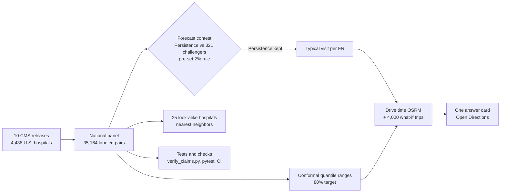

# ERNow Boston

[](https://github.com/ishaannars/ERNow-Boston/actions/workflows/tests.yml)

**Project goal:** “Find the ER that gets you seen and home fastest, not just the closest, lowering the decision time between needing one and finding a good one you can use.”

<!-- RECRUITER-TOP -->
**[Try ERNow Boston →](https://ernowboston.streamlit.app/)**

I built ERNow because live ER wait times could be years away, and comparing Boston ERs today means checking several sources by hand. ERNow puts every Boston general ER side by side with a tested forecast of the typical visit plus your drive. Hopefully you never need it, but I think a tool like this should exist.

> Possible emergency? Call 911 or go to the nearest appropriate emergency department. Do not delay care or drive farther because of an ERNow estimate.

## Results

- **9.4-minute average error** (R² 0.93) on 4,017 U.S. hospitals the model never saw. Half were within 7 minutes.
- **Picked the quickest ER in 83% of counties**, compared with 24% by chance.
- **37 minutes shorter** typical visit than picking any ER in the same county, across 340 counties.
- **Honest ranges:** 85% of real values landed inside the 80% range in the test year.

## What I learned

The simplest model won. I tested 321 challengers against last year's published number, and none cleared a 2% bar I set before testing. I also tested 5 extra ideas, including hospital crowding and flu season. None made ERNow more accurate, and each result is reported below.

## How it works



ERNow uses CMS data from 4,438 hospitals and 35,164 labeled release pairs across ten releases. It forecasts each hospital's median ED visit (CMS OP-18b), adds an 80% range, and adds your routed drive time.

## Every factor tested

Only factors that make ERNow more accurate are used. Each rule was written before its test ran.

<!-- FACTORS:START -->
| Factor | Data | Usable live? | Result | Used in ERNow? |
|---|---|---|---|---|
| Last published ED visit time | CMS (OP-18b) | Yes | Most accurate option: 9.4-min average error on 4,017 hospitals it never saw | ✅ Center estimate |
| Past trend, other ED measures, hospital traits, state and peer averages | CMS | Yes | Made the center estimate less accurate (9.9–10.3 vs 9.4 min), so they're used only in the ranges and look-alike matching | ✅ Ranges and look-alike hospitals |
| How much ED times swung nationally in the latest release | CMS | Yes | Ranges widen or narrow with recent swings; 85% held the true value (target 80%) | ✅ Ranges |
| Drive time from where you are | OpenStreetMap routing | Yes | Added to the typical visit to find the lowest total | ✅ Your total time |
| Respiratory-illness season | CDC FluView (ILINet) | Yes | No gain, even with perfect knowledge of the coming season (rolling error 12.71 with vs 12.71 min without) | ❌ No |
| Model switching in turbulent years | CMS | Yes | +0.3%; even a perfect switch would gain only 0.8% | ❌ No |
| Correction curve for "Likely quickest" | CMS | Yes | Did not improve unseen years, so the raw simulation is shown | ❌ No |
| Hospital crowding, statewide (beds in use) | CDC NHSN | Yes | Learned model 6% better but only tied the center estimate; ranges 2.3% worse | ❌ No |
| Hospital crowding, per hospital | HHS (reporting ended 2024) | No | Only 0.09 min better per year, and no longer published | ❌ No |
| Extreme weather days | NOAA | Yes | Not tested yet | ⏳ Next to test |
| Community factors (uninsured rate, share aged 65+) | Census ACS | Yes | Not tested yet | ⏳ Next to test |
<!-- FACTORS:END -->

## More tests

<!-- EXTRA_TESTS:START -->
| Question (rule written before running) | Result | Code |
|---|---|---|
| Across the U.S., does picking by forecast beat picking any ER in the same county? | Yes: **37 min** shorter typical visit (95% CI 35–39, county bootstrap), better in **96%** of 2,070 county-years across 340 counties and 7 held-out releases; true quickest picked 76% of the time. | `research/national_impact.py` |
| Is "Likely quickest" honest? | Close: when it said 88%, the ER was quickest 89% of the time (9,861 hospital-years, 6 held-out years). A correction curve did **not** improve unseen years (Brier 0.06203 raw vs 0.06282 cross-fitted), so the raw simulation is shown. | `research/calibrate_chance_fastest.py` |
| Learned models win in turbulent years. Can a volatility signal pick the model each year? | **Not promoted.** Switching gained +0.3% (95% CI -0.1% to +0.8%); even a perfect year-by-year switch would gain only 0.8%, under the 2% bar. Persistence stays. | `research/regime_switch_test.py` |
| Does it work as well for rural, government, for-profit, and small hospitals? | No group flagged (flag = error >1.25× overall or range coverage <70%). Coverage 77%–81% across groups; 23,768 hospital-years, 6 held-out releases. | `research/equity_audit.py` |
| Does hospital crowding (beds in use) make the forecast more accurate? | **Not promoted.** Statewide crowding (still published weekly, so usable live) cut the gradient-boosting model's validation error 6% (12.6 → 11.8 min), the largest gain of any factor tested, but only brought it level with Persistence (11.8 min), short of the 2% bar. Per-hospital crowding (HHS, reporting ended 2024) lowered the learned model's rolling error by only 0.09 min over 4 years. Persistence stays. | `research/crowding_factor_test.py` |
| Does crowding make the 80% ranges more accurate? | **Not promoted.** Interval score 64.2 without vs 65.7 with crowding (lower is better, so 2.3% worse). In the 3 years where the model had crowding history to learn from, crowding helped in 1. Ranges stay as they are. | `research/crowding_range_test.py` |
<!-- EXTRA_TESTS:END -->

Write-up: [When the baseline wins](research/WHEN_THE_BASELINE_WINS.md).

## Where it's wrong

<!-- ERRORS:START -->
Test year 2026-08, 4,017 hospitals. From `research/error_analysis.py`.

- **Most estimates are close.** Half were within 7 minutes. 82% were within 15 minutes and 97% within 30. Only 0.3% missed by more than an hour.
- **The misses are concentrated.** The worst 10% of hospitals (off by 20+ minutes) account for 32% of all error.
- **It doesn't lean one way.** It guessed too low for 49% of hospitals and too high for the rest.
- **Hospitals that just changed a lot are harder.** Error was 8.2 minutes when a hospital moved 0–5 minutes in its last release and 13.4 minutes when it moved 30+.
- **Bigger EDs are harder.** Error was 8.1 minutes for the smallest EDs and 10.6 for the largest.

The range model uses each hospital's latest change and national swings as inputs, so ranges are wider where misses are more likely.
<!-- ERRORS:END -->

## Why it matters

- In the latest data, typical visits ranged from **2h 26m** at BMC–Brighton to **5h 36m** at BIDMC, a **3h 10m** gap among the seven general EDs.
- In Massachusetts, the share of treat-and-release ED visits over four hours rose from **32.95%** (Oct–Dec 2019) to **44.06%** (Jul–Sep 2025) ([CHIA ED databook](https://www.chiamass.gov/wp-content/uploads/cmsr-edd-quarterly-databook-10-01-2019-to-3-31-2026.xlsx), sheet VI-1, preliminary).
- At **83%** of 2,001 sampled Boston-area locations, a different ER had the lowest estimated drive plus typical visit. The median difference was about **1h 38m** for about **13 minutes** of extra driving.

## The model

Every challenger had to beat Persistence (the last published median) by at least 2% on validation. Features always come from releases before the one being predicted. I also tested 35 blends of the four models ([research report](research/README.md)) and an [expanded search](research/EXPANDED_RESULTS.md) of 321 configurations. Four of those beat 2% on time error, but each made local ER choice worse, so none passed.

Ranges use gradient-boosting quantile regression with conformal calibration. They widen or narrow with how much ED times moved in the latest release. Peer comparisons use the 25 most similar hospitals by ED volume, type, ownership, rating, and case-mix measures.

<!-- MODEL_RESULTS:START -->
Trained and tested on **eligible reporting U.S. hospitals** in 10 CMS Hospital Compare releases (2017–2026): **4,438 hospitals, 35,164 labeled release pairs**, then applied to Boston's general emergency departments. Targets are published hospital medians, not individual visit lengths.

**Final test release** (4,017 held-out hospitals; selected on the preceding release, scored once):

| Model | Selection-release MAE | Test-release MAE | Test R² |
|---|---|---|---|
| Partial pooling (nudged toward similar hospitals) | 11.6 min | 9.4 min | 0.933 |
| Persistence (latest reported value) | 11.8 min | 9.4 min | 0.931 |
| Gradient boosting | 12.6 min | 10.3 min | 0.924 |
| Ridge regression | 13.0 min | 10.7 min | 0.918 |

The best challenger, Partial pooling (nudged toward similar hospitals), was 1.7% better in the selection year, short of the 2% bar, so ERNow uses **Persistence (latest reported value)**. Ranges: **85%** of target-80% ranges contained the observed hospital median (95% CI 84%–86%), median width 34 min. Selected the shortest observed hospital median **83%** of the time (95% CI 78%–87%) vs **24%** by chance across 293 counties with at least three eligible hospitals; drive time excluded.

**Year by year (rolling backtest: each year trained only on earlier years):**

| Held-out release | Persistence MAE | Best challenger MAE | ERNow's rule used | Median range coverage | Persistence county pick |
|---|---|---|---|---|---|
| 2020-10 | 11.1 min | 10.8 min | — | 81% | 75% |
| 2021-10 | 15.9 min | 15.4 min | Ridge regression | 66% | 71% |
| 2022-07 | 12.0 min | 11.7 min | Ridge regression | 97% | 75% |
| 2023-10 | 14.5 min | 13.8 min | Gradient boosting | 55% | 74% |
| 2024-10 | 13.6 min | 13.4 min | Gradient boosting | 88% | 71% |
| 2025-11 | 11.8 min | 11.6 min | Persistence | 83% | 76% |
| 2026-08 | 9.4 min | 9.4 min | Persistence | 85% | 83% |

Run year by year, ERNow's promotion rule averaged **12.8 min** error vs **12.9 min** for always using Persistence, switching to a learned model in 4 of 6 years and doing worse in 1.
<!-- MODEL_RESULTS:END -->

## Decision time

<!-- DECISION_TIME:START -->
- **Recorded decision times** ("ER near me", pick the closest): **9 s in ERNow (5 participants) vs 20 s for the search (5 participants)**. Recorded medians from a small convenience sample; the search protocol chooses the nearest ER. This is not a controlled trial or a population-wide speed estimate.
- **Recorded manual comparison:** gathering the same facts by hand (each ER's ED time and drive time) took 6 min 21 s (1 participant).

Timed with `python timing_test.py` (protocol in `TIMING_TEST.md`).
<!-- DECISION_TIME:END -->

## How ERNow compares

| Option | What it gives you | What ERNow adds |
|---|---|---|
| CMS Care Compare | Official CMS numbers, one hospital at a time, already 9–12 months old | Every Boston general ER side by side, forecast forward, with your drive |
| ProPublica's ER Wait Watchers (2013) | Average waits from CMS data for ERs near a ZIP code | A tested forecast with ranges and one clear answer |
| Hospital-system apps (for example, Inova's) | Live waits at that system's own ERs | A comparison across every system |
| Paid wait-time apps (for example, a $6.99 App Store app) | Advertised real-time waits with no data source listed | Free, and every number traces to public data |
| "ER near me" search | The closest ER | The lowest estimated total time |

## Limits

- ERNow forecasts **hospital medians**. Your own visit depends on how sick you are and on that day.
- CMS publishes about **9–12 months** after each reporting period ends.
- Drive times are routed estimates without live traffic.
- Specialist, pediatric, and VA ERs are listed separately because they serve different patients.

## Run it

```sh
pip install -r requirements.txt
streamlit run app.py
python scripts/verify_claims.py   # check every published number against the saved results
python -m pytest -q               # unit tests and data checks
```

Rebuilding the national model needs the original CMS archives ([setup](HISTORICAL_DATA_SETUP.md)). New CMS releases are checked weekly, and `scripts/refresh_release.sh` retrains and commits only if every check passes. Sources are in [DATA_SOURCES.md](DATA_SOURCES.md), verified claims in [CLAIMS_AUDIT.md](CLAIMS_AUDIT.md), and model details in [MODEL_CARD.md](MODEL_CARD.md).

## Coming next

- Test extreme weather days (NOAA) and community factors (Census ACS) under the same 2% rule.
- More cities. The national model already covers any U.S. city with CMS-reporting hospitals.
- Plug in live hospital data the day hospitals publish it.
- A licensed version for organizations that route people to care. ERNow stays free for patients.

## Earlier version

The first ERNow modeled 36 hospital-period observations across 6 Boston hospitals. That was too little data to beat the baseline, so I scaled to the 4,438-hospital national panel. The original pipeline is in [research/legacy/](research/legacy/).

## Stack

Python · Streamlit · scikit-learn · pandas · NumPy · CMS · CHIA · CDC · OpenStreetMap / OSRM

© 2026 Ishaan Narasimhan. All rights reserved.
